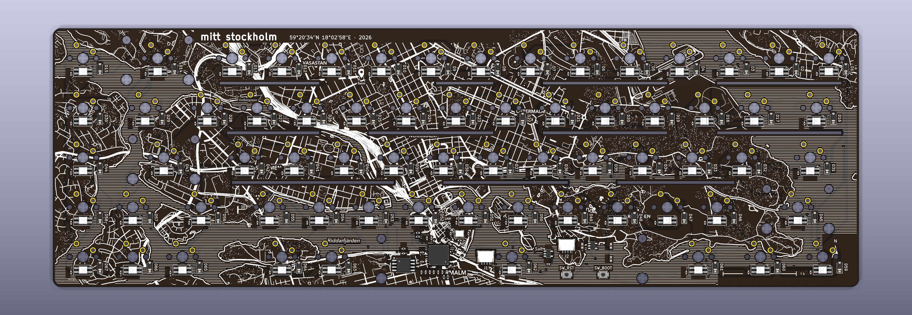

# hem

A 65% ANSI keyboard PCB with an RP2040 on the board, per-key RGB and a small OLED.
The back of the PCB is a street map of central Stockholm, with a pin at home ("hem" in Swedish), 59°20'34"N 18°02'58"E.
It is meant to be seen through a clear acrylic bottom. The case files will follow.



## What's in this repo

| Folder | Contents |
|---|---|
| `pcb/` | `hem_gerbers.zip` (Gerbers + drills), `hem_bom.csv` and `hem_cpl.csv` (assembly), `hem_layers.pdf` (every layer at 1:1, for checking) |
| `pcb/kicad/` | The KiCad 10 board (`hem.kicad_pcb`), with its project and design rules |
| `firmware/hem/` | QMK keyboard definition and default keymap |
| `images/` | Renders |

## Specs

- 65% ANSI layout, 67 keys, MX switches (soldered)
- RP2040, 16 MB flash, USB-C via a Unified Daughterboard (C5 JSH or C3) on a JST-SH cable
- 67 reverse-mount SK6812MINI-E RGB LEDs, one under each switch
- 0.91" 128 x 32 SSD1306 OLED on a JST-SH connector
- PCB-mount (screw-in) stabilizers: 3 x 2u + 1 x 6.25u
- PCB: 308.8 x 99.25 mm, 2 layers

## Ordering the PCB

Upload `pcb/hem_gerbers.zip` to PCBWay or JLCPCB:
2 layers, FR-4 1.6 mm, **black** solder mask, **white** silkscreen, **ENIG**, 1 oz copper,
min track/space 0.15 mm (6 mil), min hole 0.3 mm, internal cut-outs (LED holes and slots).

For assembly, add `hem_bom.csv` and `hem_cpl.csv`.
There are 235 SMD parts on both sides: 18 on the top and 217 on the bottom.
Mark the SK6812MINI-E as **reverse-mount**.
You solder the switches yourself.

## Firmware

```
cp -r firmware/hem <qmk_firmware>/keyboards/hem
qmk compile -kb hem -km default
```

To flash: hold BOOT, plug in USB (or press RESET while holding BOOT), and copy the `.uf2` file to the `RPI-RP2` drive.

## Before the first plug-in

Measure 5 V, 3.3 V and GND for shorts with a multimeter.

## License

MIT, see `LICENSE`.
The map on the back of the PCB is made from OpenStreetMap data: © OpenStreetMap contributors, available under the
Open Database License (ODbL), https://www.openstreetmap.org/copyright
